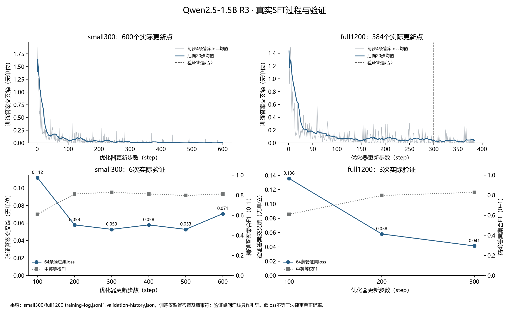

# worker-02 固定交付页

后续沿用本页，不另开日报分支。维护者：worker-02；任务：T2、T5，以及相关执行基础设施。取证日期：2026-11-06（北京时间）；本次只核对、整理和发布既有成果，新增模型调用、业务实验与独立 QA 重跑均为 0。

[返回唯一总入口](https://github.com/zik-wang/banxing-agent/blob/codex/afk-progress-board-20261104/docs/progress/README.md) · [统一发布规范](https://github.com/zik-wang/banxing-agent/blob/codex/afk-progress-board-20261104/docs/progress/PUBLISHING.md)

## 先看结论

- 合同主流程继续选择 **27B 单 Agent**，因为它承担合同理解、跨条款审查和报告组织；计算器只补强金额环节。没有证据证明默认财务多 Agent 更好。
- 本地 1.5B **已有 R2/R3 实际微调和评测**；R3 两个适配器均未通过完整预设门槛。R4 是重新规范的公开人工参考任务，**完整三种子训练尚未启动**，不能声称已证明可靠或超越 27B。
- 8884 已有 **S08、S10、S05 三个合成案例的真实页面执行与独立 QA PASS**；这不是 18 场景全部通过。S19 仍为部分完成。
- 本页代码已经发布不等于部署。当前 8884 使用独立运行副本，非本源码工作树；其当前部署 commit **unknown**。本轮未切换或重启服务，未核实当前模型连接状态。

## T2：合同审核、金额与财务协作

[方案说明及 Word 报告](../contract-review-20261104/README.md) · [下载 Word 工作报告](../contract-review-20261104/合同审核主流程方案选择工作报告.docx) · [三方案总对照](../reports/2026-11-04-t2-supplement/README.md) · [脱敏结果](../reports/2026-11-04-t2-supplement/results.json) · [计算器源码](../../v8-tools/money-calculator.mjs) · [实验复现说明](../../experiments/money/README.md)

已完成的有限验证：8 个开发合成金额案例中，历史三组的数值或正确拒答均为 8/8，初轮严格来源定位均为 7/8。对于同一大额例，预期 **128,648,000.00 元**，历史 27B、单 Agent＋计算器、宿主编排财务组均给出该值；本地 R2 在其训练任务之外的金额协议探查给出 **125,000,000 元**，漏计分项。旧提示未完整冻结，不能据此宣称严格公平的整体模型排名。

既有金额修复的独立 QA 第三轮限定范围通过：46 项独立用例、10 项既有专项测试；历史含税错例由 600 修正为 636，Word 内容回读通过。这与整份合同语义准确率是不同指标。

未完成：真实生产 A→B 计算→A 最终复核仍缺完整证据。历史 429、UNKNOWN_ASSET、v1 摘要域拒绝分别保留；不能把后续单条 v2 成功补写为整条生产链通过。

[v1 原始未验证结论](../reports/2026-11-05-t2-real-verify/README.md) · [五域协议候选](../reports/2026-11-05-t2-protocol-v2/README.md) · [v2 一次真实前瞻复核](../reports/2026-11-05-t2-v2-real-verify/README.md) · [回执透传候选源码](../../v8-tools/handoff-money.mjs)

v2 的一次真实请求获得 model verified／宿主 passed；既有独立 QA 核对的是 **1 案例、46 项一致性断言**，不是 46 案例，也不证明模型逐项理解五个摘要域。[固定独立 QA 结论](https://github.com/zik-wang/banxing-agent/blob/44ffc3dff8934b237e8595d412766d91eb6dfa91/docs/evaluations/2026-11-05/worker05-c30e33d-real-v2-evidence-qa.txt)

## T2：1.5B SFT 的实际过程与限制

[R2 既有微调说明](../contract-local-1p5b.txt) · [R3 完整结果说明](../../experiments/contract-sft-r3/RESULTS.md) · [R3 脱敏指标 JSON](../../experiments/contract-sft-r3/RESULTS.json) · [R3 复现代码](../../experiments/contract-sft-r3) · [R4 方法与限制](../../experiments/contract-sft-r4/README.md) · [R4 资源修复快照](../../experiments/contract-sft-r4/REPAIR_STATUS.json)

R3 基础模型为 Qwen2.5-1.5B-Instruct，BF16＋FP32 LoRA，rank8，学习率 1e-4。small300 实际执行 600 次更新，full1200 实际执行 384 次更新，均选中 step300；完整组因约 116 分钟未解释间隔触发时间预算，未延长。192 条测试 QA × 3 组得到 576 次实际本地生成，不是 576 份合同。原始协议分与事后格式兼容诊断分分开保留；任务定义歧义及数据增删原因见结果说明。

[下载曲线 PNG](worker-02-assets/sft-r3-loss.png) · [下载矢量 SVG](worker-02-assets/sft-r3-loss.svg)

曲线直接复制既有产物，未重绘。图中两组验证机会不同，且中文例外题参考范围存在歧义；loss 下降不等于法律审查准确率。**R3 两个适配器均未通过完整门槛，不替换 27B。**

R4 仅使用原 CUAD 人工监督的英文证据片段：训练 1,200 QA、验证 64 QA、测试 108 QA／54 份未用于旧实验的测试合同。不是新建中文法务 Gold，也不是第三方盲测。固定种子 61106／61107／61108，各 300 步；测试须在三组权重选择完成后才执行。

R4 的 BF16 选择性损失方案与 NF4＋关闭缓存方案，各完成过 5 次资源探测更新／20 次微批计算。21 项具名代码检查及 45 项来源／划分审计通过；这些不是模型准确率。NF4 与 BF16 不数值等价，只能在相同 NF4 基线上比较微调收益；不合并历史成绩。**当前正式训练 0 步、留出测试输出 0。** 本轮已停止尚未触发的资源等待，避免在仅整理交付时自动启动新工作；后续完整训练和可靠性评估仍未完成。原始失败、冻结数据及探测记录保留本机。

## T5：8884 已有页面案例及实际成果下载

以下均为此前的真实页面上传→模型／工具执行→最终答复→下载回读，输入是明确标注的合成验收材料。下载文件从既有成果原样复制，SHA256 与原记录相同；本轮没有重新执行案例。[文件清单与校验摘要](worker-02-assets/artifacts.json) · [既有独立 QA 状态摘要](worker-02-assets/verification-index.json)

- **S08-001 版本比较：独立 QA PASS，2026-11-05。** 修改、新增与不变共 5 个业务行均已绑定原输入；历史 4 次内网请求。[原执行端记录](../reports/2026-11-05-s08-intranet-result.json) · [查看 Markdown 成果](worker-02-assets/s08-comparison.md) · [下载 Word 成果](worker-02-assets/s08-comparison.docx)。原执行端 JSON 保留当时“待独立 QA”的状态；后续 PASS 时间为 2026-11-05 12:15:58 北京时间，见本页 QA 摘要。Word 文本／表格回读通过，视觉分页未渲染，不能扩大为版面验收。
- **S10-001 台账合并：独立 QA PASS，2026-11-05。** 首轮缺少 CSV 导出失败保留；修复后 4 次内网请求，去掉 1 条完全重复，实际 5 行，合计 1,500.00 元。[执行与 QA 摘要](../reports/2026-11-05-s10-intranet-result.json) · [下载实际 CSV](worker-02-assets/s10-merged.csv)。这是一个案例的 28 项开发回读断言，不是 28 案例。
- **S05-001 静态邮件归档与跟进草稿：独立 QA PASS，2026-11-05。** 历史 1 次内网请求，确认当前回复与旧引用的区别并交付草稿。[执行与 QA 摘要](../reports/2026-11-05-s05-intranet-result.json) · [查看实际报告／草稿](worker-02-assets/s05-follow-up.md)。未连接邮箱、未发送邮件、未建立持续监控；保留“立即发送”建议措辞的 P3 观察项。
- **S19-001 静态代码修复：部分完成，未独立 QA 通过。** 修改副本和补丁已有静态核对，最终答复未解释修改原理，用户目标未完整满足。未运行上传代码、未创建 PR。[未完成范围](../reports/2026-11-05-s19-intranet-result.json)

演示入口是部署机本地的 `http://127.0.0.1:8884/`；GitHub 不会托管这个服务，其他电脑不能用该地址访问本机。现有页面代码见 [V8 Web](../../v8-web) 与 [工具入口](../../v8-tools/run.mjs)。本轮没有远程演示部署，也没有声称现有运行副本已更新到本分支 HEAD。

## 相关基础设施候选

[共享 SF 请求槽说明](../v8-sf-shared-slot-candidate.md) · [128 项离线检查摘要](../reports/2026-11-05-sf-shared-slot/results.json) · [跨进程验证摘要](../reports/2026-11-05-sf-crossprocess/results.json) · [请求边界源码](../../v8-tools/siliconflow-queue.mjs)

既有证据区分了本机 mock 检查、两个真实客户端进程＋真实隔离调度器＋mock 上游，以及一次真实受控供应商回执。跨进程测试没有调用真实 SF 上游，不占生产槽；测试短间隔不代表修改生产 60 秒间隔。128／134 等断言数量不是业务案例数；不据此宣称当前 8884 全站已部署该候选。财务回执透传候选也只有定向离线证据，真实全链仍待验证。

## 发布与证据版本

复用分支 `codex/money-8884-20261104`，不创建新远端分支。源码／报告基线已核对为 [2e3f424](https://github.com/zik-wang/banxing-agent/commit/2e3f4244b7ec8ad1c0514f7a203035fb96fdb09f)；R3 固定结果见 [ed2b25f 的结果说明](https://github.com/zik-wang/banxing-agent/blob/ed2b25f8323939135df37c845554e9cae18bda87/experiments/contract-sft-r3/RESULTS.md)。[本交付页实际发布提交历史](https://github.com/zik-wang/banxing-agent/commits/codex%2Fmoney-8884-20261104/docs/progress/worker-02-latest.md)随发布更新；精确发布 SHA 与核对后的远端 SHA 写入本机统一回执。

本次 GitHub 只增加固定交付页、6 个已检查的合成／汇总成果副本及脱敏索引。不上传合同正文、录音、训练数据、权重、原始模型请求、凭证或运行态。本机源码目录、实际运行副本、受限报告路径及部署版本缺口仅记录在 `publishing-receipts/worker-02.json`，供总入口维护者汇总。

**状态分开：** 已 push 的证据不等于本轮部署；已有执行端自验不等于独立 QA；有限独立 QA PASS 不等于用户验收。T2 整体实验、R4 完整训练及全部办公场景仍未完成。
